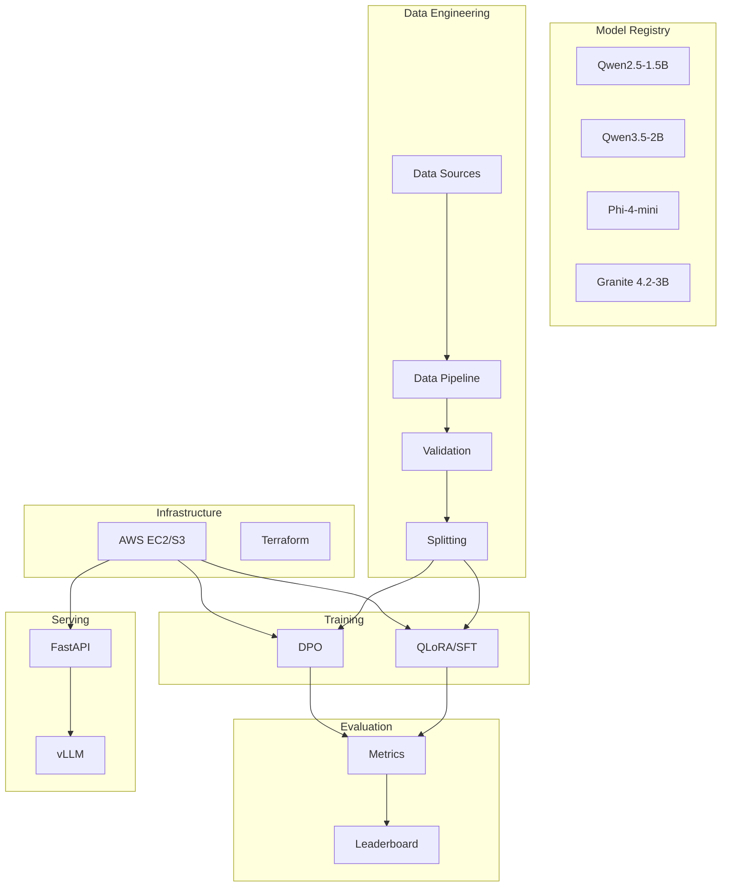

# Finr-Tuning - Multi-Model Fine-Tuning Platform

[](pyproject.toml)
[](LICENSE)
[](https://github.com/Ayush-Singh986/json-extraction-qlora-dpo/actions)
[](https://codecov.io/gh/Ayush-Singh986/json-extraction-qlora-dpo)

Production-grade ML engineering platform for multi-model fine-tuning with SFT (QLoRA), DPO, and production deployment.

---

## 🚀 Quick Start

### Prerequisites

- Python 3.11+
- PyTorch with CUDA support
- 16GB+ GPU VRAM

### Installation

```bash
cd d:\Finr-Tuning
git clone https://github.com/Ayush-Singh986/json-extraction-qlora-dpo.git repo
cd repo

python -m pip install --upgrade pip
python -m pip install -e ".[train,inference,dev]"
```

### Training

```bash
# Build dataset manifests
python scripts/build_dataset_manifests.py --profile full

# Train SFT (QLoRA)
python scripts/train_sft.py --config configs/sft.yaml --profile colab_full --run-name sft-full

# Build preference pairs
python scripts/build_preference_pairs.py --config configs/dpo.yaml --profile colab_full --run-name dpo-full

# Train DPO
python scripts/train_dpo.py --config configs/dpo.yaml --profile colab_full --run-name dpo-full

# Evaluate
python scripts/eval_model.py --config configs/eval.yaml --run-name baseline-qwen2.5-1.5b
```

### API Service

```bash
# Start inference server
python -m finrtuning.serving.api

# Test inference
curl http://localhost:8000/models
curl http://localhost:8000/health
```

---

## 📚 Documentation

| Document | Description |
|----------|-------------|
| [ARCHITECTURE.md](ARCHITECTURE.md) | System architecture and design |
| [DATASET_CARD.md](DATASET_CARD.md) | Dataset documentation |
| [MODEL_CARDS.md](MODEL_CARDS.md) | Model documentation |
| [TRAINING_GUIDE.md](TRAINING_GUIDE.md) | Training procedures |
| [EVALUATION_GUIDE.md](EVALUATION_GUIDE.md) | Evaluation methodology |
| [DEPLOYMENT_GUIDE.md](DEPLOYMENT_GUIDE.md) | Deployment procedures |
| [MONITORING_GUIDE.md](MONITORING_GUIDE.md) | Monitoring setup |
| [TROUBLESHOOTING.md](TROUBLESHOOTING.md) | Common issues |

---

## 🏗️ Architecture



---

## 📊 Performance Metrics

| Model | JSON Validity | Schema Pass | Micro F1 | Latency (ms) |
|-------|--------------:|------------:|---------:|-------------:|
| Qwen2.5-1.5B | 0.9998 | 0.9876 | 0.3030 | 10,760 |
| Qwen2.5-1.5B + SFT | 0.9990 | 0.8492 | 0.7334 | 10,773 |
| Qwen2.5-1.5B + DPO | 0.9984 | 0.9982 | 0.7730 | 16,000 |

---

## 🧰 Tech Stack

- **Python** - Core language
- **PyTorch** - Deep learning framework
- **Transformers** - Hugging Face models
- **PEFT** - LoRA adapters
- **BitsAndBytes** - 4-bit quantization
- **TRL** - SFT/DPO training
- **vLLM** - High-performance inference
- **FastAPI** - REST API
- **MLflow** - Experiment tracking
- **AWS EC2/S3** - Cloud infrastructure
- **Terraform** - IaC
- **Prometheus/Grafana** - Monitoring

---

## 🛠️ Development

```bash
# Install development dependencies
pip install -e ".[dev]"

# Run tests
pytest tests/ -v --cov=finrtuning

# Format code
black src/ scripts/ tests/

# Lint
ruff check src/ scripts/ tests/

# Type check
mypy src/
```

---

## 📂 Repository Structure

```
d:\Finr-Tuning\repo\
├── configs/              # Configuration files
├── scripts/              # CLI scripts
├── src/finrtuning/       # Python package
│   ├── config/          # Configuration management
│   ├── data/            # Data engineering
│   ├── models/          # Model registry
│   ├── training/        # Training modules
│   ├── evaluation/      # Evaluation framework
│   ├── tracking/        # MLflow integration
│   ├── serving/         # FastAPI service
│   └── leaderboard/     # Model selection
├── infrastructure/      # AWS/Terraform configs
│   └── aws/            # Terraform modules
├── .github/workflows/   # CI/CD pipelines
├── tests/               # Unit tests
├── Dockerfile           # Docker image
├── Makefile             # Development helpers
└── README.md            # This file
```

---

## 🤝 Contributing

1. Fork the repository
2. Create a feature branch
3. Make changes and add tests
4. Run `pytest tests/ -v`
5. Submit a pull request

---

## 📄 License

MIT License - see [LICENSE](LICENSE) file.

---

## 👤 Author

**Ayush Singh** - AI Engineer

---

## 🙏 Acknowledgments

- Qwen team for open-weight model release
- Hugging Face for ecosystem tools
- vLLM team for high-performance inference

---

**Built for ML Engineering Demos and Recruiter Interviews**